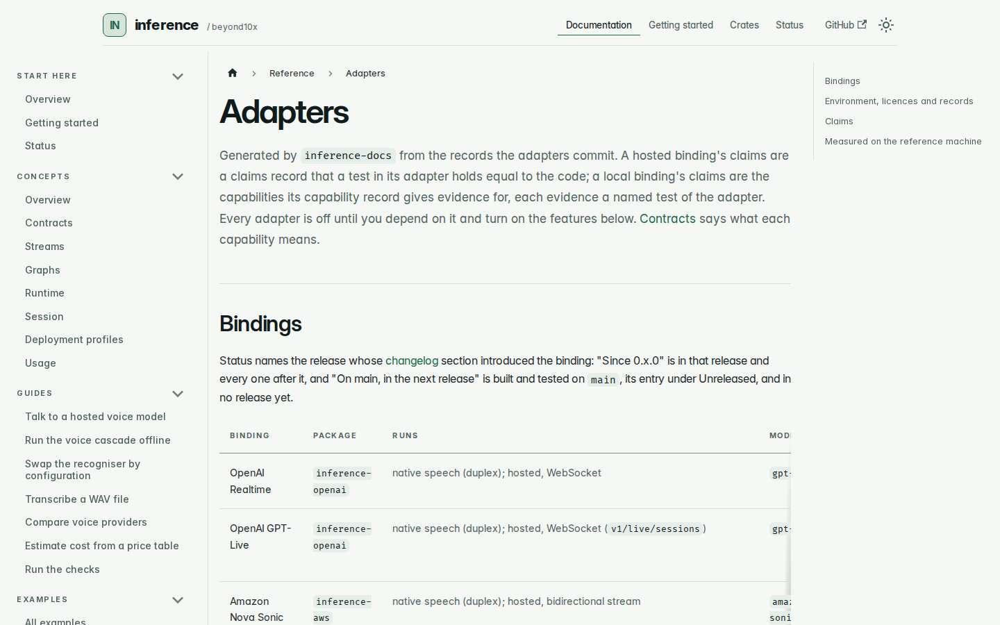
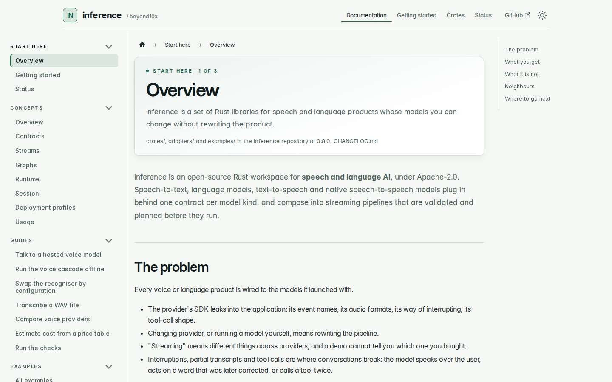
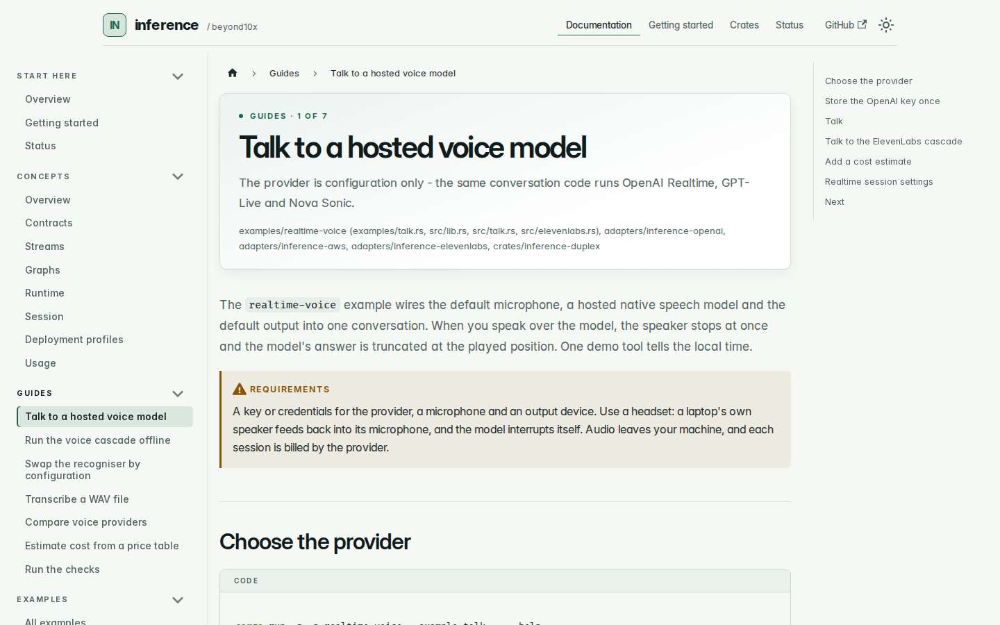
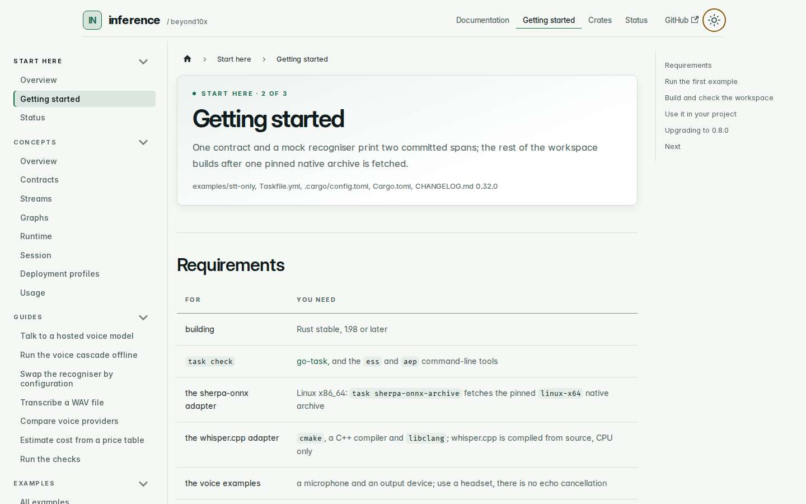
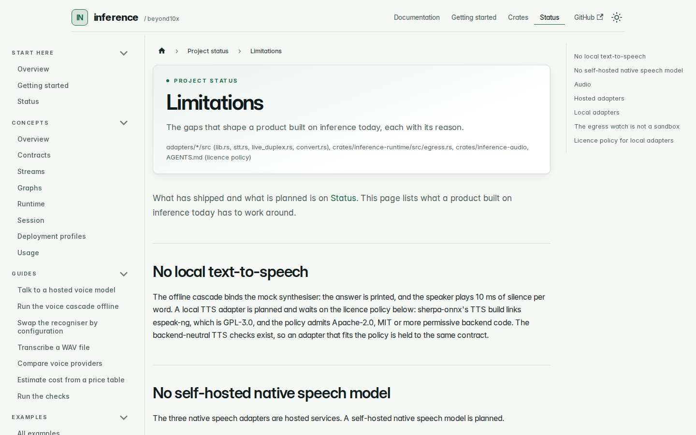
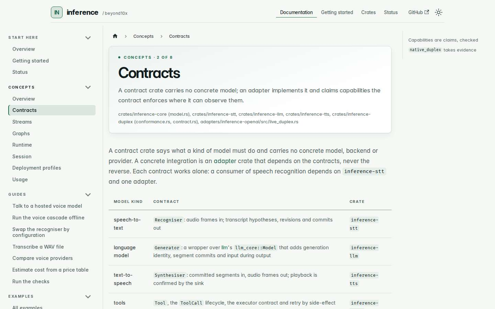
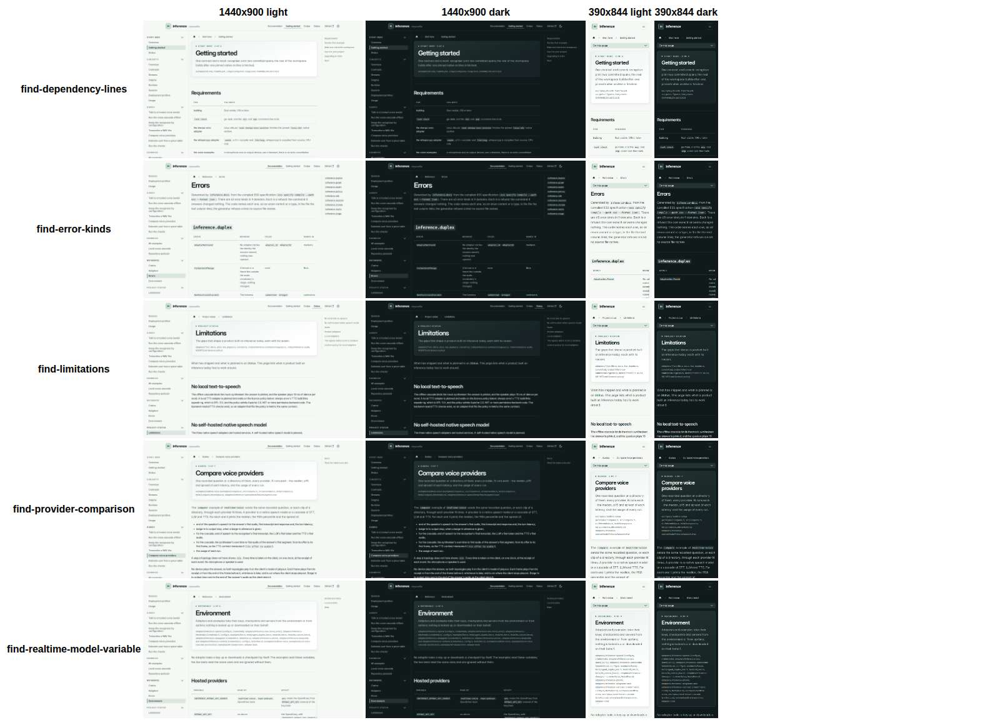

# R-01: measure

Site: inference documentation, built from commit 7c853682a, measured 2026-11-23. Gating viewports 1440x900, 390x844; measured only 1280x800, 1024x768, 768x1024; themes light, dark.

## Gates

| gate | check | value | result | counts |
|---|---|---|---|---|
| 1 | no horizontal scroll, no element past its box | 0 | pass | page states with horizontal scroll plus overflowing elements |
| 2 | always visible: navbar, search, theme toggle, sidebar at desktop | 324 | FAIL | misses at the top and at a reading position: half the page, at most to where the article ends |
| 3 | unmissable completion | 0 | pass | completion_miss over every task run; false_complete cannot occur, completion is the truth page |
| 4 | screen-only user completes every task | 0 | pass | runs that did not reach the truth page |
| 5 | axe 0 serious or critical, keyboard reaches nav and search | 264 | FAIL | serious or critical nodes plus navbar controls Tab does not reach |
| 6 | cue truth | n/a | dropped | the site has no guidance cue |

## Scenario cards

| scenario | card | task |
|---|---|---|
| find-dependency-lines | anchor | Find the Cargo dependency lines that add inference to a project. Start /, truth /docs/getting-started |
| find-error-kinds | anchor | Find the error kinds the graph runtime reports. Start /, truth /docs/reference/errors |
| find-limitations | rotating | Find what the library does not support yet. Start /, truth /docs/status/limitations |
| find-provider-comparison | rotating | Find how to compare the latency of hosted voice providers. Start /docs/concepts/overview, truth /docs/guides/compare-voice-providers |
| find-realtime-model-variable | rotating | Find the environment variable that picks another OpenAI Realtime model. Start /docs/getting-started, truth /docs/reference/environment |
| sitemap | anchor | Every page of the built site, read from website/build/sitemap.xml, at every gating viewport in both themes: gates 1, 2 and 5. |

## Metrics against the baseline and the last round

Last round: none. Lower is better.

| scenario | key | value | baseline | last round |
|---|---|---|---|---|
| sitemap | 1440x900/always_visible.misses | 108 | none | none |
| sitemap | 1440x900/axe.serious_critical | 134 | none | none |
| sitemap | 1440x900/keyboard.unreachable | 0 | none | none |
| sitemap | 1440x900/layout.h_scroll | 0 | none | none |
| sitemap | 1440x900/layout.overflow_elements | 0 | none | none |
| sitemap | 390x844/always_visible.misses | 216 | none | none |
| sitemap | 390x844/axe.serious_critical | 130 | none | none |
| sitemap | 390x844/keyboard.unreachable | 0 | none | none |
| sitemap | 390x844/layout.h_scroll | 0 | none | none |
| sitemap | 390x844/layout.overflow_elements | 0 | none | none |
| find-dependency-lines | 1440x900/completion_miss | 0 | none | none |
| find-dependency-lines | 1440x900/glance_cost.median | 1 | none | none |
| find-dependency-lines | 1440x900/glance_cost.p95 | 1 | none | none |
| find-dependency-lines | 1440x900/screen_only.actions | 1 | none | none |
| find-dependency-lines | 1440x900/screen_only.looks | 0 | none | none |
| find-dependency-lines | 1440x900/screen_only.steers | 0 | none | none |
| find-dependency-lines | 1440x900/screen_only.time_to_act_steps.max | 1 | none | none |
| find-dependency-lines | 390x844/completion_miss | 0 | none | none |
| find-dependency-lines | 390x844/glance_cost.median | 1 | none | none |
| find-dependency-lines | 390x844/glance_cost.p95 | 1 | none | none |
| find-dependency-lines | 390x844/screen_only.actions | 2 | none | none |
| find-dependency-lines | 390x844/screen_only.looks | 0 | none | none |
| find-dependency-lines | 390x844/screen_only.steers | 0 | none | none |
| find-dependency-lines | 390x844/screen_only.time_to_act_steps.max | 1 | none | none |
| find-error-kinds | 1440x900/completion_miss | 0 | none | none |
| find-error-kinds | 1440x900/glance_cost.median | 1 | none | none |
| find-error-kinds | 1440x900/glance_cost.p95 | 3 | none | none |
| find-error-kinds | 1440x900/screen_only.actions | 2 | none | none |
| find-error-kinds | 1440x900/screen_only.looks | 1 | none | none |
| find-error-kinds | 1440x900/screen_only.steers | 0 | none | none |
| find-error-kinds | 1440x900/screen_only.time_to_act_steps.max | 2 | none | none |
| find-error-kinds | 390x844/completion_miss | 0 | none | none |
| find-error-kinds | 390x844/glance_cost.median | 1 | none | none |
| find-error-kinds | 390x844/glance_cost.p95 | 3 | none | none |
| find-error-kinds | 390x844/screen_only.actions | 4 | none | none |
| find-error-kinds | 390x844/screen_only.looks | 1 | none | none |
| find-error-kinds | 390x844/screen_only.steers | 0 | none | none |
| find-error-kinds | 390x844/screen_only.time_to_act_steps.max | 2 | none | none |
| find-limitations | 1440x900/completion_miss | 0 | none | none |
| find-limitations | 1440x900/glance_cost.median | 1 | none | none |
| find-limitations | 1440x900/glance_cost.p95 | 3 | none | none |
| find-limitations | 1440x900/screen_only.actions | 2 | none | none |
| find-limitations | 1440x900/screen_only.looks | 1 | none | none |
| find-limitations | 1440x900/screen_only.steers | 0 | none | none |
| find-limitations | 1440x900/screen_only.time_to_act_steps.max | 2 | none | none |
| find-limitations | 390x844/completion_miss | 0 | none | none |
| find-limitations | 390x844/glance_cost.median | 1 | none | none |
| find-limitations | 390x844/glance_cost.p95 | 3 | none | none |
| find-limitations | 390x844/screen_only.actions | 4 | none | none |
| find-limitations | 390x844/screen_only.looks | 1 | none | none |
| find-limitations | 390x844/screen_only.steers | 0 | none | none |
| find-limitations | 390x844/screen_only.time_to_act_steps.max | 2 | none | none |
| find-provider-comparison | 1440x900/completion_miss | 0 | none | none |
| find-provider-comparison | 1440x900/glance_cost.median | 1 | none | none |
| find-provider-comparison | 1440x900/glance_cost.p95 | 1 | none | none |
| find-provider-comparison | 1440x900/screen_only.actions | 1 | none | none |
| find-provider-comparison | 1440x900/screen_only.looks | 0 | none | none |
| find-provider-comparison | 1440x900/screen_only.steers | 0 | none | none |
| find-provider-comparison | 1440x900/screen_only.time_to_act_steps.max | 1 | none | none |
| find-provider-comparison | 390x844/completion_miss | 0 | none | none |
| find-provider-comparison | 390x844/glance_cost.median | 1 | none | none |
| find-provider-comparison | 390x844/glance_cost.p95 | 3 | none | none |
| find-provider-comparison | 390x844/screen_only.actions | 2 | none | none |
| find-provider-comparison | 390x844/screen_only.looks | 1 | none | none |
| find-provider-comparison | 390x844/screen_only.steers | 0 | none | none |
| find-provider-comparison | 390x844/screen_only.time_to_act_steps.max | 1 | none | none |
| find-realtime-model-variable | 1440x900/completion_miss | 0 | none | none |
| find-realtime-model-variable | 1440x900/glance_cost.median | 3 | none | none |
| find-realtime-model-variable | 1440x900/glance_cost.p95 | 3 | none | none |
| find-realtime-model-variable | 1440x900/screen_only.actions | 1 | none | none |
| find-realtime-model-variable | 1440x900/screen_only.looks | 1 | none | none |
| find-realtime-model-variable | 1440x900/screen_only.steers | 0 | none | none |
| find-realtime-model-variable | 1440x900/screen_only.time_to_act_steps.max | 1 | none | none |
| find-realtime-model-variable | 390x844/completion_miss | 0 | none | none |
| find-realtime-model-variable | 390x844/glance_cost.median | 1 | none | none |
| find-realtime-model-variable | 390x844/glance_cost.p95 | 3 | none | none |
| find-realtime-model-variable | 390x844/screen_only.actions | 2 | none | none |
| find-realtime-model-variable | 390x844/screen_only.looks | 1 | none | none |
| find-realtime-model-variable | 390x844/screen_only.steers | 0 | none | none |
| find-realtime-model-variable | 390x844/screen_only.time_to_act_steps.max | 1 | none | none |

## Measured-only viewports

| viewport | horizontal scroll states | overflowing elements | always-visible misses |
|---|---|---|---|
| 1280x800 | 0 | 0 | 108 |
| 1024x768 | 0 | 0 | 108 |
| 768x1024 | 0 | 0 | 216 |

## Worst moments

- /docs/reference/adapters at 1440x900, light: search: not on the page; after scroll: search: not on the page; axe link-in-text-block

  

- /docs at 1440x900, light: search: not on the page; after scroll: search: not on the page; axe link-in-text-block

  

- /docs/guides/talk-to-a-hosted-voice-model at 1440x900, light: search: not on the page; after scroll: search: not on the page; axe link-in-text-block

  

- /docs/getting-started at 1440x900, light: search: not on the page; after scroll: search: not on the page; axe link-in-text-block

  

- /docs/status/limitations at 1440x900, light: search: not on the page; after scroll: search: not on the page; axe link-in-text-block

  

- /docs/concepts/contracts at 1440x900, light: search: not on the page; after scroll: search: not on the page; axe link-in-text-block

  

## Key moments

Each task's truth page at every gating viewport and theme, 0.75 s after arrival: 

## Inputs not in this round

- Recorded sessions of people (L6), the questionnaire and real-user sessions (L8): none.
- Keyed replay (L4) and the discoverability probe (L5): not run, no paid levels in this round.
- Guidance cue (L0, gate 6): the site has none.
